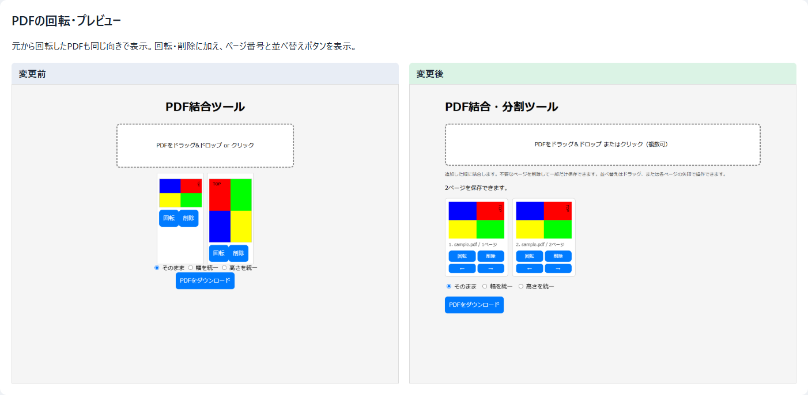
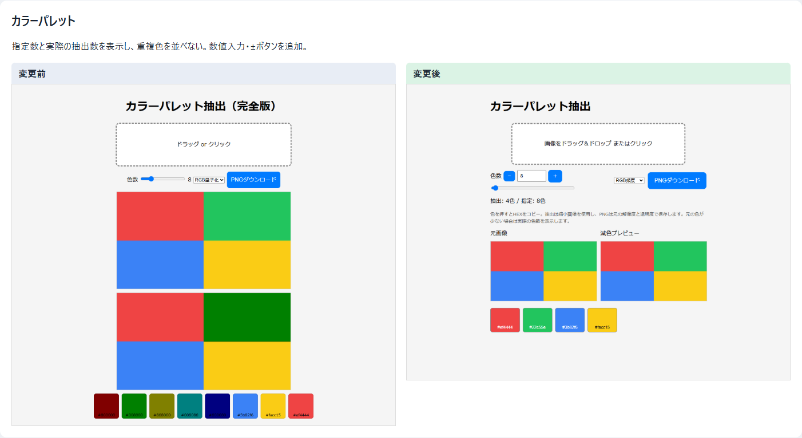

# 既存ツールの点検・修正記録

2026年10月19日。画像11・音声6・ユーティリティ9の計26ツールに入力を与えて主要な操作を点検し、17ツールを修正した。ポータルとゲーム22本を含む49ページで、PC幅1280px・スマホ幅390pxの起動確認も行った。

ページの統合は行わず、既存URLと直接処理できる入口を維持した。新しい機能一覧や作業モードの選択は追加していない。

[全15画面の変更前後を比較する](comparison.html) / [検証結果の詳細JSON](results.json)

## 操作数と統合の判断

ファイルをドラッグ投入した後の代表的な操作を比較した。ファイル選択・保存先のOSダイアログと、両方に共通する文字入力・シーク操作は含めない。

| 操作 | 変更前 | 変更後 |
| --- | ---: | ---: |
| PDFを結合して保存 | 保存1回 | 保存1回 |
| PDFの1ページを90度回転して保存 | 回転＋保存2回 | 回転＋保存2回 |
| パレット抽出した画像を保存 | 保存1回 | 保存1回 |
| 画像を半分のサイズで保存 | 倍率＋保存2回 | 倍率＋保存2回 |
| 画像をタップして透過し保存 | 対象タップ＋保存2回 | 対象タップ＋保存2回 |
| 画像列から動画を作成して保存 | 生成＋保存2回 | 生成＋保存2回 |
| 動画から音声を抽出して保存 | 抽出＋保存2回 | 抽出＋保存2回 |
| 動画をシークした位置でPNG保存 | 画像化＋保存2回 | 保存1回 |
| NPYを一括変換してZIP保存 | 保存1回 | 保存1回 |
| 2つのCSSから差分を保存 | 処理1回 | 処理1回 |

透過ツールと線画変換は、対象色の指定と輝度からの変換で目的が異なる。リサイズとレイヤー画像処理も、後者へ移すとレイヤー追加や書出しメニューの操作が必要になる。動画の音声抽出と汎用変換は一部重複するが、専用ページのWAV高速処理と単純な設定には利点がある。これらは独立したままにした。ドット絵作成とPixel Workbenchも、作成と確認という役割が異なるため統合しない。

## 修正した17ツール

| ツール | 問題と変更 |
| --- | --- |
| [PDF結合・分割](../../Utility/PDFJoiner/) | 元の回転情報を無視したプレビューと、回転後の書出し位置を修正。ページをコピーして回転情報を更新し、テキストとリンク注釈を維持する。切抜き領域・UserUnitを含む幅/高さ統一にも対応。ファイルの追加順を固定し、ファイルごとに1つのプレビュー用PDFを再利用。ページ名・番号、タッチでも使える並べ替え矢印、読込・エラー表示を追加。PDF.js/pdf-libを同梱。 |
| [パレット抽出](../../Image/CreateColorPalette/) | 小さい画像で空のサンプルを引く処理、余分な色や重複色による水増しを解消。3方式の抽出を決定的な処理に変更し、透明画素を除いて数える。指定2〜256色の数値入力と±ボタンを追加。元の色が少ない場合は実際の抽出数を表示。原寸・元のアルファを保持してPNG保存。Workerで処理し、連続変更では古い計算を中止する。 |
| [画像透過](../../Image/AlphaTool/) | 処理で元の透明度が復活していた問題を修正。対象色の入力だけでも色依存処理を行えるようにし、初期の色表示と内部値を一致させた。元画像・アルファマップの表示中でも、保存するのは透過結果にした。別画像の読込時に前の選択位置・結果をリセット。 |
| [線画→透過](../../Image/Line2AlphaConverter/) | 黒/白背景から変換するときも元画像の透明度を反映。ファイル選択のキャンセル時の例外を防止。 |
| [画像リサイズ](../../Image/Resize/) | 0・空欄・不正サイズから誤った画像を保存しないようにした。1px画像の倍率縮小も最低1pxに保つ。読込後の倍率表示と実際の寸法を一致させた。Lanczosの座標・縮小時のサポート範囲・透明色の混入を修正し、乗算済みアルファによる2段階の補間へ変更。中間画像にもサイズ上限を設けた。 |
| [画像→動画](../../Image/Image2Video/) | 読込完了まで生成を止め、枚数と進捗を表示。実際にPNGへ変換し、異なる画像サイズは縦横比を保って黒い余白で合わせる。奇数寸法は偶数へ調整。指定FPSの画像列としてエンコードし、再実行時の上書き確認待ちを防止。失敗時も処理中表示を閉じ、メモリ上の一時ファイルを削除。設定・画像順の変更で古い出力を無効化。 |
| [動画→画像](../../Image/Video2Image/) | 読込とシーク後のプレビューを自動更新。動画フレームが実際に届いてから保存を有効にし、直後に透明PNGや前のフレームを保存する競合を解消。「1フレーム」と表記していた固定30fpsの移動は「1/30秒」へ修正。読めない動画では前の画像を保存させない。 |
| [SVG編集](../../Image/EditSVG/) | 読込時に捨てていたviewBoxと継承属性を維持。元のtransformを保って移動できるようにし、回転の開始時に角度が飛ぶ処理を修正。保存範囲は編集用ハンドルを除く実要素から計算し、viewBox変換を二重に含めない。不正SVGで前の内容を消さない。 |
| [動画→音声](../../Audio/Video2Audio/) | MP3にFloat32波形をそのまま渡していた問題を修正し、16bit PCMに変換する。5.1chはステレオへ混ぜてセンターの音声を失わないようにした。元形式の抽出は実際の音声コーデックに合った入れ物を選択。読込時の自動再生をなくし、ファイル名を文字として表示。変換失敗時も処理表示を閉じ、再試行できるようにした。lamejsを同梱。 |
| [リアルタイム文字起こし](../../Audio/RealTimeWhisper/) | 認識器には16kHzのFloat32波形を渡す。重複推論を止め、遅い処理中もバッファを制限。停止後に古い結果を追記しない。マイクの全トラックを終了し、開始・認識失敗を表示。スマホ用viewportと初回モデル読込の案内を追加。 |
| [マイク解析](../../Audio/RealTimeAudioAnalyzer/) | 二重開始でマイクと描画ループを増やさない。停止時はトラックと描画予約を終了。マイク取得待ち中に停止した場合も、遅れて届いたストリームを終了する。失敗表示と再試行に対応。 |
| [深度マップ](../../Utility/DepthPreview/) | NPY v1/v2/v3、float32/64、整数の一部、byte order、Fortran順をヘッダから判定する。NaN・定数画像も扱う。クリック選択、進行表示と投入数を追加。同名ファイルをZIP内で上書きせず、不正ファイルを個別に報告。全失敗時に以前のZIPを残さない。JSZipを同梱。 |
| [CSS差分](../../Utility/CSSDiffRemovalTool/) | 正規表現による平坦化で、メディアクエリ・同一セレクタの複数規則・文字列内の区切りを壊す処理を修正。元の規則を保ち、単独の明確な重複だけを削除。入れ子や順序に影響する宣言は保持する。スマホでは入力欄を折り返す。 |
| [メディア変換](../../Utility/MediaConverter/) | スマホでの設定欄と長いコマンドの横はみ出しを修正。変換手順は変更せず。 |
| [RE10K生成](../../Utility/RealEstate10Kcreatemeta/) | 不正な距離/FOV、0・逆向き・極小ステップを拒否。行数上限と生成行数を表示し、極端な入力による長いループを防止。スマホのviewportを追加。 |
| [文字列の総当たり](../../Utility/RoundRobinString/) | 記号を含む変数名や`$`を置換式として解釈せず、文字通りに扱う。計算モードでも通常の文字変数を維持。不正なJSONでは編集中の内容を置き換えない。重複変数名と10万件を超える組み合わせを拒否。 |
| [JSONLグラフ](../../Utility/jsonl2graph/) | 壊れたJSON・非オブジェクト・不正な進捗値の行番号を表示。読み込み失敗時は前のグラフを維持。欠損や非数値の測定値はグラフの欠損点として扱う。 |

## 検証

実Chrome / Playwrightで合計111項目に合格。PDFは保存後にPDF.jsで再読込して向き・四隅の色・寸法・テキスト・リンク注釈を照合した。PNGはPillowで寸法と透明度を照合し、動画は同梱ffmpeg.wasmで実際に変換した。音声は保存後に再デコードして長さとRMS音量を確認した。

| テスト群 | 確認内容 |
| --- | --- |
| `verify_tools.py` | PDF全回転角・切抜き・サイズ統一・追加順と並べ替え、パレット3方式・1px・透明画像・256色・連続変更、NPYの型/バージョン/配列順・同名ZIP・失敗回復 |
| `verify_media.py` | 透過結果の保存、4方式のリサイズ、動画のシーク、混在サイズ画像列のMP4、WAV/MP3/Opus、5.1chのダウンミックス |
| `verify_controls.py` | CSS・RE10K・総当たり・JSONL・SVG・線画・ドット絵・マスク・レイヤー処理、模擬マイクと推論による開始/停止/失敗の制御 |
| `verify_other_tools.py` | 汎用変換の実PNG出力、WAV/WebMのメタデータ、MMLの保存/読込/再生、ご飯ルーレット |
| 既存の3テスト群 | FileLedger 43項目、BackListen 24項目、Pixel Workbench 12項目に合格。これら3ツールの実装は変更していない |
| `scan.py --after` | 49ページで初期JS例外なし。PC/スマホ幅のページ全体の横はみ出しなし。ノノグラムの末尾画像探索に伴う404は既存仕様として確認 |

再現用スクリプトは [scripts/tool_audit](../../scripts/tool_audit/) に保存した。個別チェック名と最終起動確認は [results.json](results.json) に記録した。

文字起こしの入力形式は [Transformers.jsの公式API](https://huggingface.co/docs/transformers.js/v2.17.2/en/pipelines#module_pipelines.AutomaticSpeechRecognitionPipeline) も参照した。

## 確認範囲

26ツールの代表的な入力・出力・エラー回復を確認した記録であり、任意のファイル形式や全入力を網羅した保証ではない。実機のマイク許可・画面共有ダイアログ、実音声の文字起こし精度、全ブラウザでの互換性、大容量ファイルの長時間試験は対象外。MMLのOS保存ダイアログは開かず、通常のダウンロード経路で検証した。ゲーム22本は起動時のみ確認し、全ステージやゲームバランスは検査していない。SVGの操作は既存のPCマウス操作を基準に確認した。

作業開始前から存在したステージ済み/未コミットの変更と、既存の別作業の成果物は今回のコミット対象から除外した。

## 代表的な画面比較

左が変更前、右が変更後。両方へ同じPDFと同じ回転操作を与えた例では、元から90度回転した2ページ目の向きも修正後は一致する。

パレットは色数・元画像・減色後を同時に確認できるようにした。

残りの画面は [全15画面の比較](comparison.html) から確認できる。
